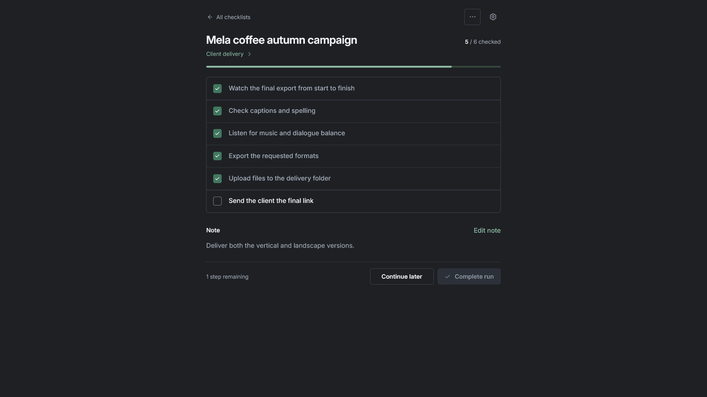
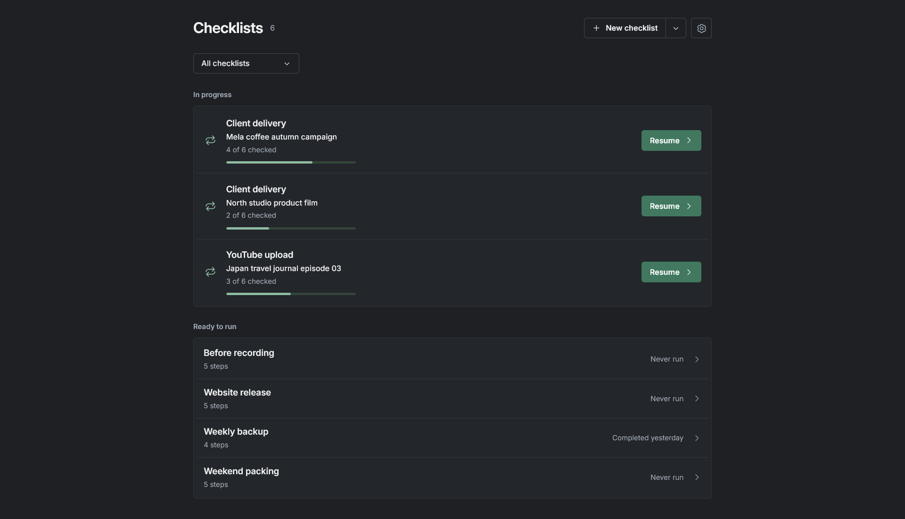
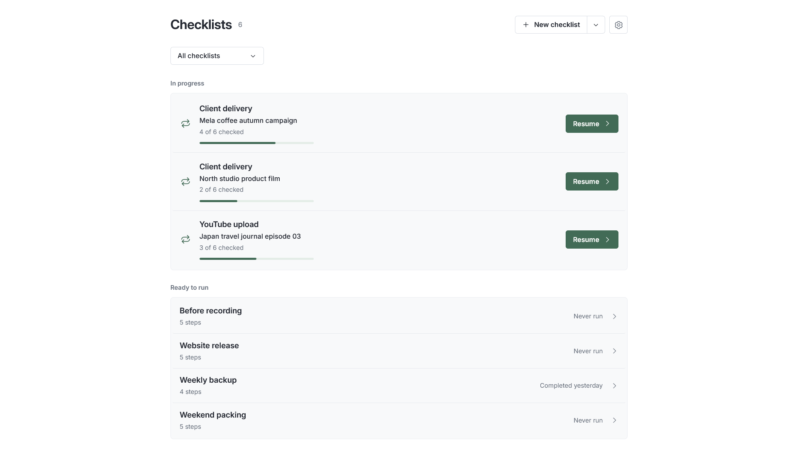
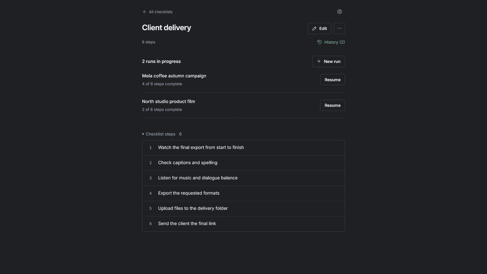
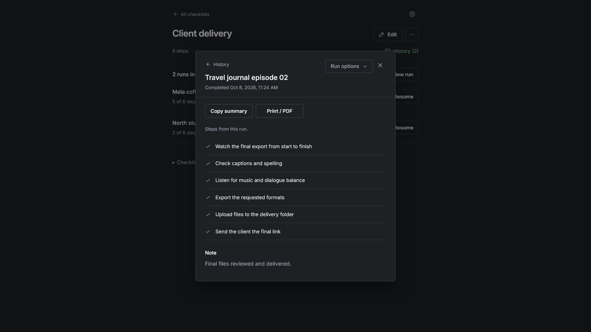

# Runseta

**Your checklist. Ready to run again.**

Reusable checklists for Windows. Follow every step, save your progress, and keep a record of each completed run.

Runseta is preparing for its Microsoft Store release. Downloads are not publicly available yet.

## See it in action

Create your checklist once, start a fresh run for each project, and resume unfinished work whenever you are ready. Complete a run after every step is checked, then reuse the checklist next time.

Useful for client deliveries, recording preparation, website releases, and weekly backups.

## Free and Pro

| Feature | Free | Pro |
| --- | --- | --- |
| Reusable checklists | Up to 3 | Unlimited |
| Active runs per checklist | 1 | Multiple |
| Saved progress and run notes | Included | Included |
| Completed run history | Included | Included |
| Backup and restore | Included | Included |
| Light and dark themes | Included | Included |
| Folders | — | Included |
| Copy summary and Print / PDF | — | Included |

Pro is planned at **US $7.99 as a one-time purchase** through Microsoft Store, with no subscription. Local prices and applicable taxes will be shown before purchase.

## Your projects at a glance

Light appearance

Multiple runs and completed history

Screenshots show the real app with sample projects. Some pictured features require Pro.

## Privacy and support

Checklist work is stored locally and works offline. Runseta does not provide its own cloud synchronization. Installation, purchases, and some Store license checks require an internet connection.

Read the [privacy policy](https://zematools.github.io/runseta/privacy.html) after GitHub Pages is enabled. For questions or feedback, email [serviceamanuel@gmail.com](mailto:serviceamanuel@gmail.com).

Developed by **Amanuel Yohannes**.

## About this repository

This repository contains the public product website and screenshots. It does not contain the Runseta desktop application's source code.

The website uses plain HTML, CSS, and JavaScript. Enable GitHub Pages from the `main` branch and `/ (root)` folder. No build step is needed.

Inter is distributed under the [SIL Open Font License](assets/Inter-LICENSE.txt).
